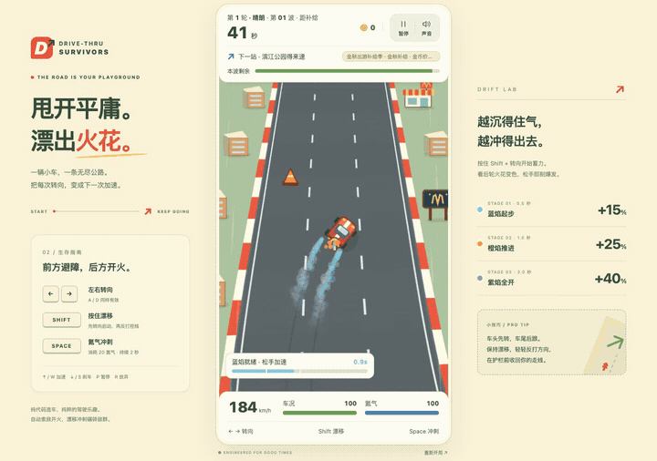
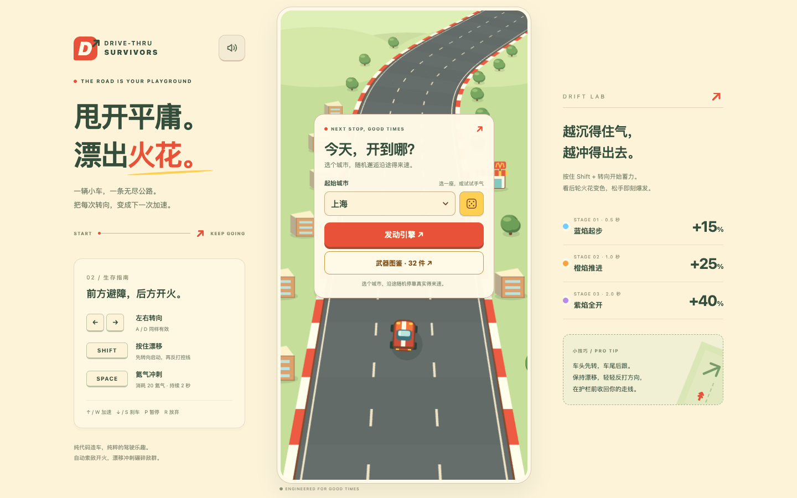
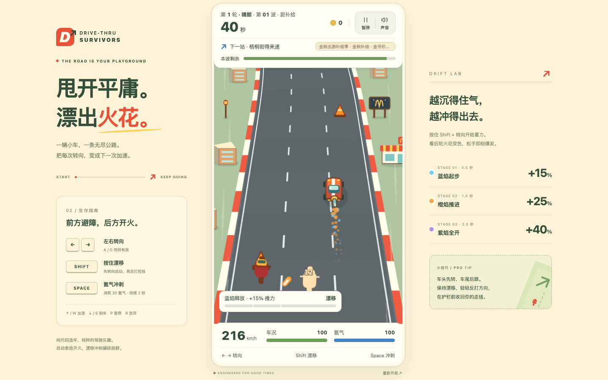
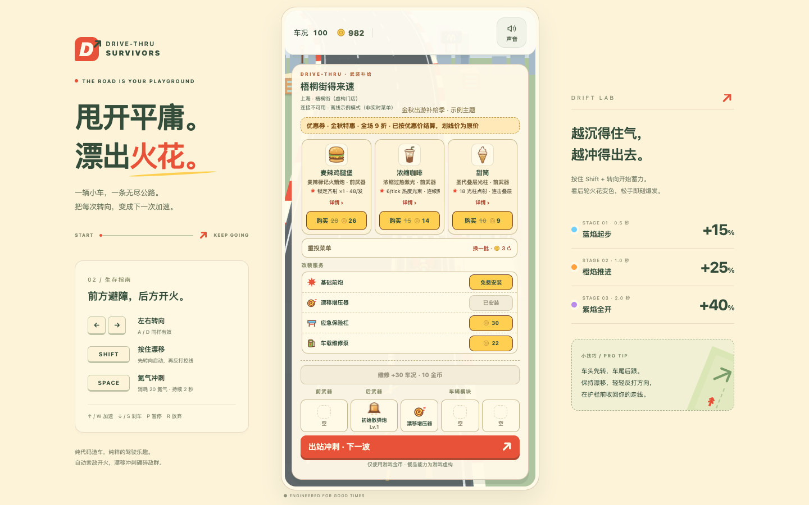
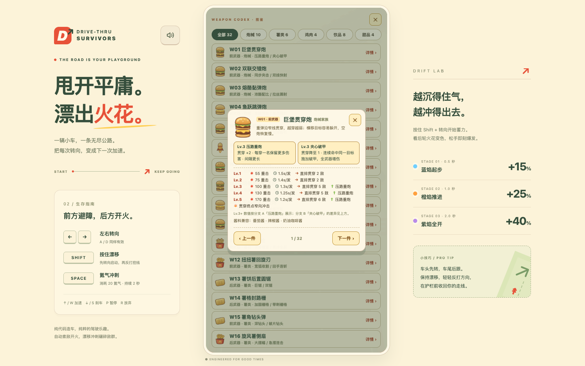
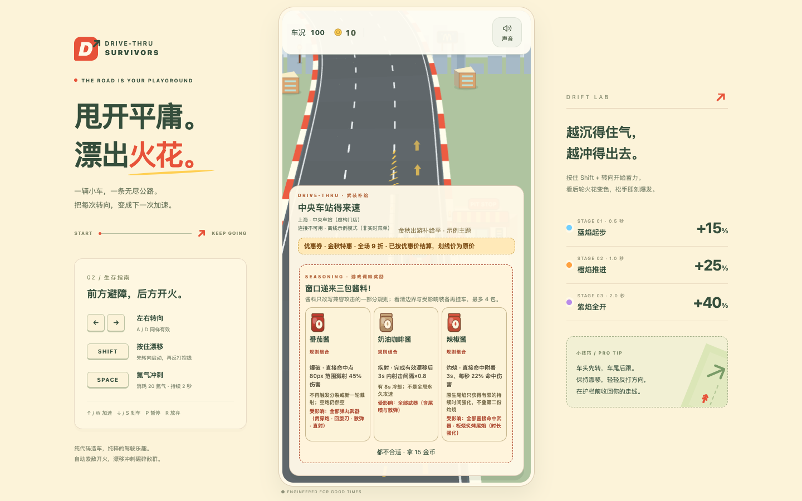
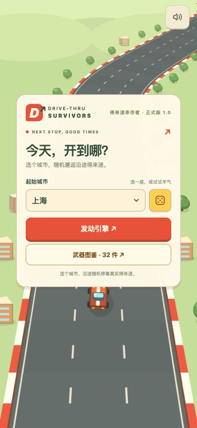
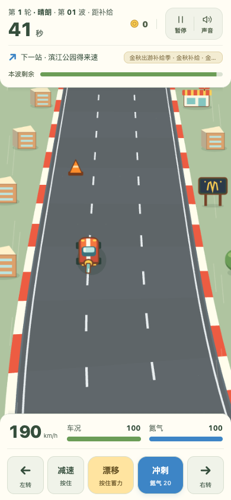

<h1 align="center">Drive-Thru Survivors</h1>

<p align="center"><b>得来速幸存者 · 1.0</b></p>

<p align="center"><b>漂移、开火，在下一家得来速停靠前活下来。</b></p>

<p align="center">街机漂移赛车 × 《土豆兄弟》式自动射击生存 × 麦当劳真实菜单</p>

<p align="center">浏览器游戏 · 桌面 / 移动端 · 简体中文</p>

<p align="center">
  <a href="#快速开始">开始驾驶</a> ·
  <a href="#游戏截图">游戏截图</a> ·
  <a href="#玩法">玩法</a> ·
  <a href="#技术实现">技术实现</a> ·
  <a href="#深入阅读">设计文档</a>
</p>

<p align="center">
  
</p>

## 关于这款游戏

《得来速幸存者》是一场发生在无尽公路上的 20 波生存赛。你驾驶一辆会自动开火的改装赛车，在车流、路障和疯狂骑手之间漂移、冲刺、收集金币；每波结束驶进路边的得来速，用本店菜单里的餐品改装武器、购买车辆模块、升级构筑，然后带着新火力冲进下一轮。

菜单和门店来自麦当劳官方 MCP 的只读快照；没有 Token 或网络不可用时，游戏会自动切换到虚构的示例菜单。所有交易只使用游戏内金币，不涉及真实点单、支付或优惠券核销。

一条命，四轮二十波，四场霸王级 Boss 战。跑完全程，或者在半路把车况耗尽。

> 一条无尽公路，一辆会自动开火的赛车，和一份会变成武器的真实菜单。

## 特色

- **漂移是核心输出，不只是过弯动作。** 按住漂移并转向蓄力，蓝、橙、紫三段火花对应 +15% / +25% / +40% 的速度脉冲；漂移释放期间撞击伤害更高，氮气冲刺也能把追兵甩开。
- **自动开火，专心走位。** 车尾武器会自动索敌射击；每份餐品对应一件车载武器。32 件餐品武器可以升到 Lv.5，Lv.3 时二选一分支，改变武器的行为方式。
- **20 波，4 轮，4 个 Boss。** 每 5 波迎战一档霸王级卡车，第 4 个 Boss 击破后通关；中途进站可以补给、改装，再开下一轮。
- **得来速商店，每次停靠都要取舍。** 每站展示 3 张已核价餐品卡；可以付费重投换一批、同名升阶、替换旧武器、维修车况。另有 3 个车辆模块、免费基础前炮和最多 4 包酱料。
- **酱料改写规则。** 甜酸酱让弹丸弹墙，番茄酱添加溅射，辣椒酱附加灼烧，奶油咖啡酱在有效漂移后开启射速窗口——不是简单的数值加成。
- **真实菜单，离线也能玩。** 有 Token 时读取官方 MCP 的真实餐厅菜单；没有 Token、断网或服务不可用时自动切换到示例模式，并在游戏内明确标注。
- **桌面与手机同一套玩法。** 桌面使用键盘；手机使用底部触控按钮。竖屏赛道、固定 60Hz 物理步长、对象池和程序化美术共同保证流畅度。
- **图鉴与本地纪录。** 武器图鉴收录 32 件餐品武器的逐级数值、分支说明和酱料兼容；结算页记录最远里程、最远波次、最多消灭、最高连击和最近三次构筑。

一套完整内容：3 辆赛车、32 件餐品武器、3 个车辆模块、4 种酱料、20 波战斗和 4 个霸王级 Boss。四档 Boss 依次是霸王皮卡、双挂霸王、狂暴车队长、终极麦霸王。

## 游戏截图

截图来自 1.0 构建，使用离线示例菜单。

**标题与起始城市**



| 驾驶与漂移 | 得来速商店 |
| :---: | :---: |
| [](docs/assets/screenshots/gameplay.png) | [](docs/assets/screenshots/shop.png) |

| 武器图鉴 | 酱料三选一 |
| :---: | :---: |
| [](docs/assets/screenshots/codex.png) | [](docs/assets/screenshots/sauce.png) |

**移动端**

| 移动端标题 | 移动端驾驶 |
| :---: | :---: |
| [](docs/assets/screenshots/mobile-title.png) | [](docs/assets/screenshots/mobile-play.png) |

## 玩法

| 阶段 | 你会做什么 |
| --- | --- |
| 出发 | 选择起始城市与三辆赛车之一；倒计时结束后自动油门起步。 |
| 驾驶 | 在 20 波、4 轮的战斗中漂移蓄力、释放氮气、自动开火；每 5 波迎战 Boss。 |
| 停靠 | 每波结束驶入得来速：从 3 张餐品卡中选购，付费重投，升阶或替换武器，维修车况，购买车辆模块。 |
| 结算 | 通关或抛锚后统计里程、消灭、最高连击、剩余金币与最终五槽构筑。 |

一局有 5 个装备槽：前武器、后武器和 3 个车辆模块。

- **前武器 / 后武器**：由餐品映射而来，同名餐品可以喂养同一件武器升阶；不同武器之间需要替换。
- **车辆模块**：独立购买的被动改装，不占餐品卡；漂移增压器、应急保险杠和车载维修泵分别强化增伤、容错与续航。
- **初始装备**：一开局带后置散弹炮；第一站提供免费基础前炮，避免早期没有前向火力。
- **重投**：换一批未购买的已核价餐品；价格随波次上涨，同一站连续重投更贵，已购餐品不会再次出现。

金币来自击杀、连击里程碑、进站底薪和 Boss 奖励；升阶、维修、模块和重投都要花金币。收入随敌人密度增长，支出也随波次变贵，所以每次停靠通常只够办一两件大事。

### 赛车

| 赛车 | 定位 | 被动 |
| --- | --- | --- |
| 闪电红 | 均衡高速 | 最高速度 +8%；氮气自动回复 +0.5/秒 |
| 寒冰蓝 | 冲撞控场 | 冲撞使敌人减速 50%，持续 2 秒；冰冻敌人受到撞击伤害 ×2 |
| 磁力金 | 经济滚雪球 | 磁吸范围 +62%；金币价值 +20% |

### 车辆模块

| 模块 | 作用 |
| --- | --- |
| 漂移增压器 | 完成有效漂移后，下一轮攻击伤害 ×1.5，最多存 3 层 |
| 应急保险杠 | 安全驾驶 10 秒积一层护盾（最多 2 层）；碎盾后 1.5 秒内受伤减半 |
| 车载维修泵 | 连续 5 秒无碰撞后缓慢回复车况 |

### 酱料

| 酱料 | 规则改写 |
| --- | --- |
| 甜酸酱 | 有弹墙能力的弹丸撞上路沿后折向新路径 |
| 番茄酱 | 直接命中产生范围溅射，但不再触发分裂或额外溅射 |
| 辣椒酱 | 直接命中附加灼烧；原生尾焰只获得时长强化，不叠第二份灼烧 |
| 奶油咖啡酱 | 完成有效漂移后开启短射速窗口，有冷却，不是永久攻速 |

## 操作方式

| 操作 | 桌面 | 移动端 |
| --- | --- | --- |
| 转向 | `←` `→` / `A` `D` | 左转 / 右转 |
| 加速 / 刹车 | `↑` / `W` 加速，`↓` / `S` 刹车 | 自动油门；按住减速 |
| 漂移 | 按住 `Shift` + 转向 | 按住漂移 + 转向 |
| 氮气冲刺 | `Space`，消耗 20 氮气，持续 2 秒 | 冲刺按钮 |
| 暂停 | `P` / `Esc` | 顶部暂停按钮 |
| 放弃本局 | `R` | 暂停面板中的“放弃本局” |
| 声音 | `M` / 顶部声音按钮 | 顶部声音按钮 |

自动油门默认开启；在暂停面板关闭后，可以用 `W` / `↑` 手动加速。漂移蓄力越久，释放后的速度脉冲越强：0.5 秒蓝焰 +15%，1.0 秒橙焰 +25%，2.0 秒紫焰 +40%。

## 快速开始

需要 Node.js 20.19+ 或 22.12+，以及 npm。

```bash
npm install
npm run dev
# 打开 http://127.0.0.1:5173/
```

不启动网关也可以直接玩：前端会使用本地示例菜单。要使用真实菜单，把 Token 放在只读网关的环境变量里：

```bash
cp .env.example .env
# 编辑 .env，填入 MCDONALDS_MCP_TOKEN
npm run dev:server
```

`npm run dev:server` 启动 `127.0.0.1:3002` 的只读 MCP 网关，Vite 会把 `/api` 代理过去。Token 只放在服务端，不能使用 `VITE_` 前缀。

常用命令：

```bash
npm test        # 153 项自动测试
npm run typecheck
npm run build   # 严格类型检查 + 生产构建
npm run preview # 预览生产构建
```

浏览器内的本地纪录保存在 `localStorage`；真实菜单的首次查询可能需要数十秒，同一城市的短时间重复查询会命中网关缓存。

### 系统需求

| 项目 | 要求 |
| --- | --- |
| 运行环境 | 现代浏览器（Chrome / Edge / Safari / Firefox） |
| 图形 | WebGL 优先，自动回退 Canvas |
| 输入 | 键盘或触屏 |
| 本地开发 | Node.js 20.19+ / 22.12+、npm |
| 真实菜单（可选） | 麦当劳 MCP Token + 本地或 Vercel 网关 |
| 网络 | 示例菜单可离线；真实菜单需要访问网关 |

## 部署到 Vercel

仓库自带 Vercel 适配，将 GitHub 仓库导入 Vercel 即可发布在线版本：

1. 在 Vercel 新建项目，导入 `hexwarrior6/drive-thru-survivors`；Vite 预设会自动选择 `npm run build` 和 `dist/`。
2. 在 Environment Variables 中添加 `MCDONALDS_MCP_TOKEN`。
3. 部署。`vercel.json` 会把 `/api/*` 重写到 `api/index.ts`，运行与本地相同的 Hono 网关。

函数最长执行时间配置为 120 秒，覆盖真实快照构建的最坏情况。冷启动后的第一次真实菜单查询可能需要数十秒；同一城市在 15 分钟内会复用缓存。没有 Token 时线上同样会降级为示例模式，并在游戏内标注。

## 技术实现

| 层 | 技术 |
| --- | --- |
| 游戏渲染 | Phaser 3 |
| 语言与构建 | TypeScript（strict）+ Vite 7 |
| 服务端网关 | Hono + `@hono/node-server` |
| 数据校验 | Zod |
| MCP | `@modelcontextprotocol/sdk` |
| 自动测试 | `node:test` + `tsx` |

- 桌面使用 450×800 逻辑画布；手机保持同一逻辑宽度并扩展纵向场景。Phaser FIT 等比缩放，WebGL 优先，Canvas 回退。
- 固定 60Hz 物理步长与位置插值；弹丸、敌人、金币、粒子和伤害数字全部预分配对象池，热路径不创建临时对象。
- 道路、赛车、门店、餐品、模块图标和音效都由代码实时绘制或合成，不加载外部图片、字体或音频。
- 商店、图鉴、HUD 等界面使用 DOM 覆盖层；本地存档和结算纪录使用 `localStorage`。
- MCP 网关只允许白名单内的只读工具，Token 仅在服务端使用；前端不接触任意 MCP 调用，也不会拿到优惠券编码等敏感字段。真实菜单快照在一局开始时构建，局内零网络依赖。

```text
浏览器（Vite + Phaser + DOM UI）
        │  /api/snapshot
        ▼
只读 MCP 网关（Hono，Node / Vercel Function）
        │  白名单 MCP 工具
        ▼
麦当劳官方 MCP
```

### 项目结构

```text
src/
  scenes/      Title / Select / Game / Result
  combat/      武器、弹道、敌群与战斗表现
  systems/     波次、商店、平衡、存档、天气
  ui/          HUD、商店、图鉴、酱料、移动控制
  data/        快照、城市、餐品身份与程序化美术
server/        只读 MCP 网关
api/           Vercel 函数入口
tests/         node:test 自动测试
docs/          设计、架构与开发文档
```

## 数据与 MCP

启用真实菜单时，服务端只读调用麦当劳官方 MCP 的白名单工具：查询附近门店、菜单、单品详情、真实计价、活动日历和门店优惠。前端只收到经过 Zod 校验和脱敏的快照。

- 不使用真实支付，不创建订单，不领取或核销优惠券。
- Token 只存在服务端环境变量中，禁止使用 `VITE_` 前缀。
- 真实数据不可用时自动回退示例数据；示例门店、优惠与叙事均为虚构。
- 游戏内货币是虚拟金币；本地纪录保存在浏览器，不涉及账号或跨设备同步。

麦当劳名称、菜单名称与相关商标归其权利人所有。本项目是创意开发比赛/个人项目，不是麦当劳官方产品；请勿将游戏内价格或优惠当作真实点餐信息。

## 质量与验证

- `npm test`：153 项自动测试，覆盖驾驶物理、追兵与碰撞、武器与 Boss、商店经济、存档续玩、MCP 网关与快照校验。
- `npm run build`：严格 TypeScript 检查与生产构建。
- 浏览器 QA 覆盖桌面 1280×900、1440×900 与移动端 390×844；截图与动图均来自当前构建。
- 物理使用固定步长，渲染使用对象池与空间网格；目标是稳定 60 FPS。不同设备、浏览器和省电模式下的实际帧率仍需真机确认。

## 已知限制

- 真实菜单依赖麦当劳 MCP 与有效 Token；首次查询可能较慢，门店和菜单以官方返回为准。
- 手机端为浏览器触控体验，音频需要首次交互后解锁；低端设备的帧率与手感需实测。
- 游戏不提供账号、真实支付或优惠券核销；本地纪录不会跨设备同步。
- 示例模式中的门店、商品与价格只用于演示，不代表真实门店或官方活动。

## 深入阅读

项目的设计、数值和实现细节都在 `docs/` 目录。设计文档记录了不同阶段的规格与取舍；当前可运行数值以 `src/systems/balance.ts`、`src/combat/weaponCatalog.ts` 和实际代码为准。继续开发或调整玩法时，建议从以下文档开始：

| 文档 | 内容 |
| --- | --- |
| [VISION](docs/VISION.md) | 游戏愿景、核心循环与目标体验 |
| [GAME_DESIGN](docs/GAME_DESIGN.md) | 驾驶、战斗、武器、商店与经济设计 |
| [WEAPON_SYSTEM_REDESIGN](docs/WEAPON_SYSTEM_REDESIGN.md) | 32 件武器、五级成长与分支设计 |
| [WEAPONS_CATALOG](docs/WEAPONS_CATALOG.md) | 餐品到武器的映射与构筑示例 |
| [ART_STYLE](docs/ART_STYLE.md) | 配色、程序化美术与特效规范 |
| [TECH_ARCHITECTURE](docs/TECH_ARCHITECTURE.md) | 技术栈、渲染、性能与项目结构 |
| [MCP_INTEGRATION](docs/MCP_INTEGRATION.md) | MCP 接入规范、白名单与安全边界 |
| [PHASE_INSTRUCTIONS](docs/PHASE_INSTRUCTIONS.md) | 分阶段开发记录与验收标准 |

## 创作背景

本项目最初为麦当劳程序员节创意开发大赛而创作，当前 1.0 是面向发布的整理与打磨版本。比赛相关材料：

| 文件 | 内容 |
| --- | --- |
| [CONTEST_DECLARATION.md](CONTEST_DECLARATION.md) | 参赛声明 |
| [MCP_INTEGRATION.md](MCP_INTEGRATION.md) | 面向比赛的 MCP 业务说明 |
| [workbuddy.md](workbuddy.md) | WorkBuddy 开发对话上下文 |

关联项目：同作者的 codex-6.1-sol / McPitstop 项目为本作提供了 MCP 网关、程序化美术与 Web Audio 的参考实现，复用清单见 [reference/CODEX_REUSE_GUIDE.md](reference/CODEX_REUSE_GUIDE.md)。

## 致谢

- [Phaser](https://phaser.io/)：2D 游戏框架
- [Vite](https://vite.dev/) 与 [TypeScript](https://www.typescriptlang.org/)：开发与构建
- [Hono](https://hono.dev/) 与 [Zod](https://zod.dev/)：只读网关与数据校验
- [Model Context Protocol SDK](https://modelcontextprotocol.io/)：MCP 接入
- 麦当劳中国官方 MCP：真实菜单与门店数据

<p align="center"><sub>1.0 · Made of code. Fueled by fun.</sub></p>
